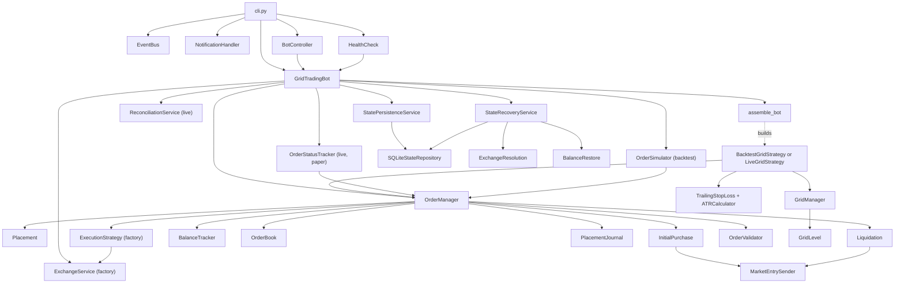
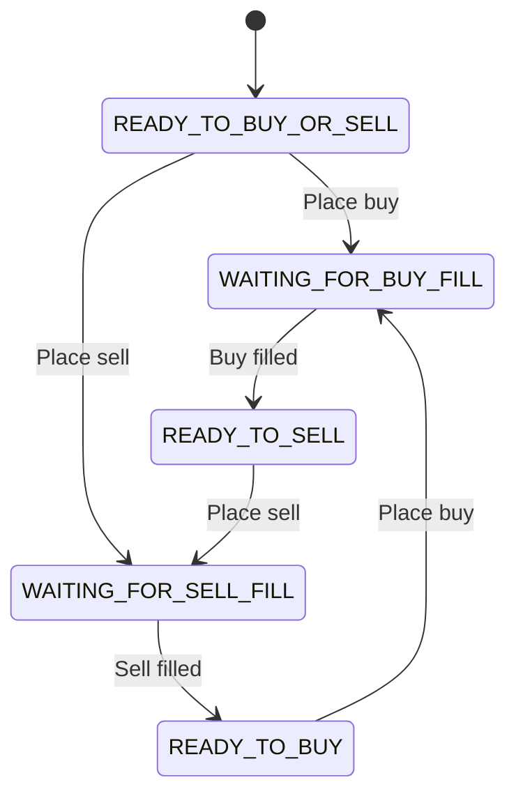

# Architecture Overview

The Grid Trading Bot follows a modular, event-driven architecture with clear separation of concerns.

## Package Layout

The project uses a **src layout**:

```
src/grid_trading_bot/
├── cli.py                              # Click CLI: run, resume; builds each bot with its controller and health check
├── __main__.py                         # python -m support
├── config/
│   ├── config_manager.py               # Loads the JSON into BotConfig
│   ├── schema.py                       # BotConfig, every default and bound, load_config
│   ├── exceptions.py
│   └── trading_mode.py                 # backtest, paper_trading, live
├── core/
│   ├── exceptions.py                   # GridBotError hierarchy
│   ├── bot_management/                 # Bot lifecycle and orchestration
│   │   ├── bot_assembly.py             # Reads the trading mode and builds the wired components
│   │   ├── grid_trading_bot.py         # Calls the assembly, runs, stops, recovers
│   │   ├── event_bus.py                # STOP_BOT only
│   │   ├── stop_request.py             # Stop kinds and exit codes
│   │   ├── supervised_loop.py          # Background loops: retry, alert, CRASH after 3 failures
│   │   ├── process_lifecycle.py        # Signal handling (SIGTERM, SIGINT, SIGUSR1)
│   │   ├── health_check.py             # Bot health, resources, account metrics
│   │   ├── bot_controller/
│   │   │   ├── bot_controller.py       # Terminal commands (orders, balance, stop, quit)
│   │   │   └── exceptions.py
│   │   └── notification/
│   │       ├── notification_handler.py # Apprise alerts
│   │       └── notification_content.py # Alert types and texts
│   ├── domain/
│   │   ├── spacing_type.py
│   │   └── strategy_type.py
│   ├── grid_management/                # Grid computation and state
│   │   ├── grid_manager.py             # Levels, static or ATR-based regrid
│   │   ├── grid_level.py               # Level state machine
│   │   └── grid_strategy.py            # simple_grid and hedged_grid pairing rules
│   ├── indicators/
│   │   └── atr_calculator.py           # ATR for dynamic spacing and the trailing stop
│   ├── order_handling/                 # Order lifecycle
│   │   ├── order_manager.py            # Lock, fill pipeline, grid init and regrid; delegates the rest
│   │   ├── placement.py                # Limit orders through the journal, retries, replacements
│   │   ├── initial_purchase.py         # Market buy that funds the sells above the price
│   │   ├── liquidation.py              # Position close, take-profit and stop-loss exits
│   │   ├── market_entry.py             # Journals market legs and sends them
│   │   ├── order.py                    # Order model (timestamps in ms)
│   │   ├── order_book.py               # Order-to-level mapping
│   │   ├── placement_journal.py        # Placements written before they are sent
│   │   ├── balance_source.py           # VIRTUAL (config, database) or EXCHANGE starting balances
│   │   ├── balance_tracker.py          # Fiat and crypto, free and reserved
│   │   ├── fee_calculator.py           # Fees in the currency received
│   │   ├── pnl_ledger.py               # Realized PnL
│   │   ├── backtest_clock.py           # Backtest: candle time stamped on the orders
│   │   ├── order_status_tracker.py     # Live and paper: polls the open orders
│   │   ├── order_simulator.py          # Backtest: fills orders from the candles
│   │   ├── order_update_handler.py     # Interface of apply_order_update
│   │   ├── state_store.py              # Interface of the state save
│   │   ├── exceptions.py
│   │   └── execution_strategy/         # Backtest vs live execution, through a factory
│   ├── persistence/                    # State persistence (live and paper)
│   │   ├── state_persistence_service.py  # One-transaction snapshots, periodic checkpoint
│   │   ├── state_recovery_service.py     # Resume, refuse or defer a start
│   │   ├── exchange_resolution.py        # Settles restored orders and journal entries against the exchange
│   │   ├── balance_restore.py            # Restores balances, reservations and accounting into the tracker
│   │   ├── state_repository_interface.py
│   │   ├── sqlite_state_repository.py    # SQLite backend (WAL)
│   │   ├── serializers.py                # Model serialization, config hash
│   │   └── run_files.py                  # Run lock and halt marker
│   ├── reconciliation/
│   │   └── reconciliation_service.py   # Live: local state vs exchange audit
│   ├── risk_management/
│   │   └── trailing_stop_loss.py       # ATR trailing stop ratchet
│   ├── services/                       # Exchange abstraction
│   │   ├── exchange_interface.py
│   │   ├── exchange_service_factory.py
│   │   ├── backtest_exchange_service.py
│   │   ├── live_exchange_service.py    # ccxt pro, sandbox for paper
│   │   ├── live_ticker_feed.py         # Websocket ticker stream, price validation
│   │   ├── circuit_breaker.py
│   │   ├── market_constraints.py       # Exchange minimums and precision
│   │   └── exceptions.py
│   └── validation/
│       ├── order_validator.py
│       └── exceptions.py
├── strategies/
│   ├── grid_trading_strategy.py        # Shared base: grid init, TP/SL, trailing stop, regrid, state export
│   ├── backtest_grid_strategy.py       # Candle loop, order simulator, report from the candles, plot
│   ├── live_grid_strategy.py           # Ticker loop, ATR refresh, report from the live metrics
│   ├── trading_strategy_interface.py
│   ├── trading_performance_analyzer.py # Metrics and the display summary
│   ├── performance_metrics.py          # Typed metrics
│   └── plotter.py                      # Plotly charts (backtest)
└── utils/
    ├── logging_config.py               # Console handler, one log file per bot
    ├── config_name_generator.py
    ├── performance_results_saver.py
    └── constants.py
```

## Module Dependencies



## Design Patterns

### Factory Pattern

Two factories select implementations based on the configured `TradingMode`:

- **`ExchangeServiceFactory`**: returns `BacktestExchangeService` or `LiveExchangeService`
- **`OrderExecutionStrategyFactory`**: returns instant (backtest) or idempotent (live) execution; every live order carries a `clientOrderId` that is looked up when the answer of the exchange is lost

### Event Bus

Decoupled communication via a publish/subscribe system, now reduced to the shutdown request.

| Event | Published When | Typical Subscribers |
|-------|---------------|-------------------|
| `STOP_BOT` | Shutdown requested (stop command, TP/SL, halt, signal) | `GridTradingBot` |

### Fill Pipeline

Order updates do not travel on the event bus. The order tracker (live and paper trading) and the order simulator (backtest) hand each exchange view of an order to `OrderManager.apply_order_update`. Under its lock, it books the newly filled quantity, moves the grid level, places the paired order (or re-places a cancelled or expired one; a rejected one is not re-placed), then saves the state. The fill notification goes out once the lock is released.

### Placement Journal

Every limit order the bot places goes through `Placement` (`core/order_handling/placement.py`, called by `OrderManager`) and a `PlacementJournal` (`core/order_handling/placement_journal.py`). `Placement` rounds the quantity and the price to the exchange precision, reserves the funds, marks the grid level as busy, writes the entry to the `pending_placements` table, then sends the order with its `clientOrderId`. An accepted order enters the order book and leaves the journal. An entry whose send failed for a transient reason stays, with its funds reserved, and the order tracker retries the journal at the end of every poll; an entry whose outcome is unknown is looked up by its `clientOrderId` before it is sent again. A refusal drops the entry and releases its funds. The reserved amounts always equal what the open orders and the journal entries hold.

The tracker applies the fills of one poll in the order the price reaches them (buys from the highest price down, then sells from the lowest up), as the backtest simulator does. Exceptions derive from `GridBotError`: a `DataFetchError` is a transient exchange failure and is retried, an `OrderRefusedError` (the bot's own checks or the exchange refusing the order) is expected and logged at WARNING.

### Supervised Background Loops

The order tracker, the reconciliation service and the periodic checkpoint each run in a `SupervisedLoop` (`core/bot_management/supervised_loop.py`). An unexpected error in one pass is logged and alerted at the first failure of a streak, and the loop runs again at its next interval; a success after failures sends `LOOP_RECOVERED`. After 3 failures in a row the loop publishes `STOP_BOT` with a CRASH request from its own task and ends, so the bot stops with its orders kept and exits 1 for the supervisor to relaunch it. Each loop exposes its state, which `get_bot_health_status` reports as `background_loops`.

### State Machine

Each `GridLevel` transitions through `GridCycleState` as orders are placed and filled:



### Strategy Pattern

`TradingStrategyInterface` defines the ABC. `GridTradingStrategy` holds the logic both modes share, and two classes built on it own what differs:

- **`BacktestGridStrategy`**: loads the history, iterates over the OHLCV rows synchronously, fills orders through the `OrderSimulator`, builds the report from the candles and plots the result
- **`LiveGridStrategy`**: consumes the WebSocket price stream asynchronously, refreshes the ATR at each candle close, builds the report from the live metrics and has no plot. It takes a `mode_label` (`live` or `paper`) for its log lines

The shared strategy handles:

1. Initial purchase (enough crypto to fund the sell orders placed above the current price)
2. Grid order initialization across computed levels
3. Order fill handling (buy fill → place sell above, sell fill → place buy below)
4. Take-profit and stop-loss monitoring

## Trading Modes

The trading mode is read in `assemble_bot` (`core/bot_management/bot_assembly.py`), which `GridTradingBot.__init__` calls, in `cli.py`, in the two factories, and in `core/bot_management/grid_trading_bot.py` for the steps that only live and paper trading take (the open-order check at a fresh start, crash and halt handling, the stop notification, health entries). The assembly builds each component with the behaviour its mode needs, so no other component asks which mode it runs in (`cli.py` builds the notification handler the same way and passes it in):

- **`fail_fast`** on `OrderManager`, which passes it to `Liquidation` (the strategy reads it from the manager). When true (backtest), the run re-raises an unexpected error while handling a fill, a booking error or an unexpected error in a liquidation attempt (including reading the exchange balance for the next attempt), and a booking error after the initial purchase. When false (live, paper), these are logged, alerted and handled. Placement errors do not read it: they are handled the same way in every mode
- **`BalanceSource`** on `BalanceTracker` and `StateRecoveryService`: `VIRTUAL` (backtest and paper) takes the starting balances from the config and restores them from the database; `EXCHANGE` (live) fetches and restores them from the exchange
- **`enabled`** on `NotificationHandler`, set by `cli.py`: alerts are sent in live and paper trading only
- **Strategy class**: `BacktestGridStrategy` or `LiveGridStrategy`; the reconciliation service (live) and the plotter (backtest) are built only for their mode

`ExchangeInterface` declares `load_exchange_markets`, `get_market_constraints` and `last_price_update_ts`, so the bot calls them on any exchange service; `BacktestExchangeService` answers from the config (`execution.backtest_min_amount`, `backtest_min_cost`). `tests/test_mode_boundaries.py` fails when `TradingMode` is named outside `config/`, `cli.py`, `core/bot_management/grid_trading_bot.py`, `core/bot_management/bot_assembly.py` and the two factories.

| Mode | Exchange Service | Execution Strategy | Additional Tasks |
|------|-----------------|-------------------|-----------------|
| `backtest` | `BacktestExchangeService` (CSV/CCXT OHLCV) | Instant fill | None |
| `paper_trading` | `LiveExchangeService` (sandbox APIs) | Idempotent, looked up by `clientOrderId` | BotController, HealthCheck, StatePersistence |
| `live` | `LiveExchangeService` (production APIs) | Idempotent, looked up by `clientOrderId` | BotController, HealthCheck, StatePersistence, ReconciliationService |

In live and paper modes, the bot runs three concurrent async tasks:

1. **Trading strategy** — Price consumption and order management
2. **BotController** — Runtime CLI commands for status and control
3. **HealthCheck** — System resource monitoring (CPU, memory)

## State Persistence (Live and Paper Trading)

In live and paper trading, the bot persists its state to a SQLite database so it can recover from crashes or restarts without losing order history, grid states, or balance tracking.

### How It Works

- **Checkpoint strategy**: a full snapshot is written in one transaction at the end of every order operation (fill with its paired order, cancellation, expiry, rejection, initial purchase, grid placement, regrid, bulk cancellation), plus a periodic checkpoint and a final one at shutdown. A failed write alerts ("Checkpoint Failed"); 3 in a row halt the bot
- **Database**: SQLite with WAL (Write-Ahead Logging) mode for crash safety
- **DB path**: `data/{BASE}_{QUOTE}/state_{config_hash[:8]}.db` (auto-derived, or explicit via `persistence.db_path` in config)

### Recovery on Restart

When the bot starts with an existing state DB, `StateRecoveryService` has one of four outcomes:

1. **Resumed**. The saved state is loaded and reconciled with the exchange (below).
2. **Refused: another grid**. The DB was written for a different grid (explicit `persistence.db_path` reused). Exit 0, "Start Refused", DB untouched.
3. **Refused: recovery failed**. An exception during recovery (corrupt row, bug). Exit 0, "Start Refused" naming the cause, DB untouched.
4. **Deferred**. The exchange is unreachable during reconciliation. Exit 75, "Start Deferred", DB untouched; the supervisor relaunches.

Nothing deletes the DB except `resume`, which archives it. With no saved state, a fresh start first checks `fetch_open_orders` for the pair: any open order refuses the start (exit 0, "Start Refused"), and a failed check defers it (exit 75).

A resume works as follows:

1. **Config compatibility**. The DB name carries a hash of `grid_strategy`, `exchange`, `pair` and `trading_settings.timeframe`; `risk_management` is not part of it
2. **Grid level restoration**. Overlays saved states and paired-level references onto freshly computed grid levels
3. **Order restoration**. Reconstructs Order objects from DB, repopulates the OrderBook
4. **Exchange reconciliation** (`ExchangeResolution`). Each journal entry that may have been sent is looked up by its `clientOrderId` first: found open, it is adopted into the book; found filled, it is booked like a fill made while the bot was down; never received, it is sent again at the first poll. A market entry (the initial purchase or a liquidation leg) that executed nothing is dropped, one found executed is booked once as closed, and one still open defers the start. A liquidation found in the journal books what it sold, sends an "Error Occurred" alert that the position may still be open, and halts the bot (halt marker, exit 0) instead of resuming the grid; sell what is left by hand, then run `resume`. Then, for each locally-open order, the bot fetches its current status from the exchange:
    - Filled (fully or partly) while bot was down → books each fill once, with its fee, and places the paired order
    - Cancelled or expired on exchange → frees the level, releases the reserved funds, and re-places the order on its level right after the recovery
    - Rejected on exchange → frees the level and releases the funds; listed in the recovery notification, not re-placed
    - Not found → marked as ghost, funds released, listed with its level in the recovery notification, not re-placed (its fate is unknown)
    - Orphan orders on exchange (neither in the local book nor in the journal) → logged as warnings, not auto-adopted; one carrying the bot's `clientOrderId` prefix also sends an alert
5. **Balance restoration** (`BalanceRestore`). Live: the balances come from the exchange, and the reserved amounts are recomputed from the open orders and the journal entries. Paper: the virtual balances come from the DB, the reserved amounts are recomputed from the open orders and the journal entries, and the fills are booked on them. If the cost basis and realized PnL cannot be restored or replayed (either mode), the recovery still resumes and sends an `ACCOUNTING_NOT_RESTORED` alert

### Configuration

```json
{
  "persistence": {
    "enabled": true,
    "db_path": "data/SOL_USDT/my_state.db"
  }
}
```

Both fields are optional. Persistence is enabled by default in live and paper trading. The `db_path` defaults to `data/{BASE}_{QUOTE}/state_{hash}.db` where `{hash}` is derived from the grid configuration, ensuring different grid configs get separate databases even for the same trading pair
