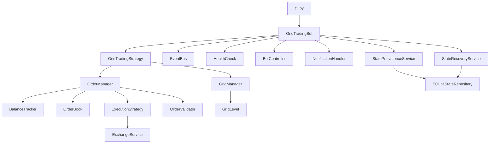
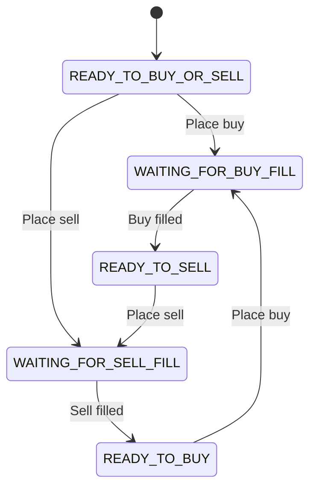

# Architecture Overview

The Grid Trading Bot follows a modular, event-driven architecture with clear separation of concerns.

## Package Layout

The project uses a **src layout**:

```
src/grid_trading_bot/
├── cli.py                          # Click CLI entry point
├── __main__.py                     # python -m support
├── core/
│   ├── bot_management/             # Bot lifecycle & orchestration
│   │   ├── grid_trading_bot.py     # Main orchestrator
│   │   ├── event_bus.py            # Pub/sub event system
│   │   ├── bot_controller.py       # Runtime CLI commands
│   │   ├── health_check.py         # System monitoring
│   │   └── notification_handler.py # Apprise alerts
│   ├── grid_management/            # Grid computation & state
│   │   ├── grid_manager.py         # Level calculation
│   │   └── grid_level.py           # Level state machine
│   ├── order_handling/             # Order lifecycle
│   │   ├── order_manager.py        # Order orchestration
│   │   ├── balance_tracker.py      # Fiat/crypto balances
│   │   ├── order_book.py           # Order-to-grid mapping
│   │   ├── placement_journal.py    # Placements not yet resolved
│   │   └── execution_strategy/     # Backtest vs live execution
│   ├── persistence/                # State persistence (live and paper)
│   │   ├── state_persistence_service.py  # State snapshots in one transaction
│   │   ├── state_recovery_service.py     # Merge recovery on restart
│   │   ├── sqlite_state_repository.py    # SQLite backend
│   │   └── serializers.py                # Model serialization
│   ├── services/                   # Exchange abstraction
│   │   ├── backtest_exchange_service.py
│   │   └── live_exchange_service.py
│   └── validation/                 # Order validation
├── strategies/                     # Trading strategies
│   ├── grid_trading_strategy.py    # Main strategy logic
│   ├── trading_performance_analyzer.py
│   └── plotter.py                  # Plotly visualization
├── config/                         # Configuration management
│   ├── config_manager.py
│   ├── config_validator.py
│   └── trading_mode.py
└── utils/                          # Logging, I/O helpers
```

## Module Dependencies



## Design Patterns

### Factory Pattern

Two factories select implementations based on the configured `TradingMode`:

- **`ExchangeServiceFactory`**: returns `BacktestExchangeService` or `LiveExchangeService`
- **`OrderExecutionStrategyFactory`**: returns instant (backtest) or idempotent (live) execution; every live order carries a `clientOrderId` that is looked up when the answer of the exchange is lost

### Event Bus

Decoupled communication via a publish/subscribe system, now reduced to the shutdown request.

| Event | Published When | Typical Subscribers |
|-------|---------------|-------------------|
| `STOP_BOT` | Shutdown requested (stop command, TP/SL, halt, signal) | `GridTradingBot` |

### Fill Pipeline

Order updates do not travel on the event bus. The order tracker (live and paper trading) and the order simulator (backtest) hand each exchange view of an order to `OrderManager.apply_order_update`. Under its lock, it books the newly filled quantity, moves the grid level, places the paired order (or re-places a cancelled or expired one; a rejected one is not re-placed), then saves the state. The fill notification goes out once the lock is released.

### Placement Journal

Every order the bot places goes through one helper in `OrderManager` and a `PlacementJournal` (`core/order_handling/placement_journal.py`). The helper rounds the quantity and the price to the exchange precision, reserves the funds, marks the grid level as busy, writes the entry to the `pending_placements` table, then sends the order with its `clientOrderId`. An accepted order enters the order book and leaves the journal. An entry whose send failed for a transient reason stays, with its funds reserved, and the order tracker retries the journal at the end of every poll; an entry whose outcome is unknown is looked up by its `clientOrderId` before it is sent again. A refusal drops the entry and releases its funds. The reserved amounts always equal what the open orders and the journal entries hold.

The tracker applies the fills of one poll in the order the price reaches them (buys from the highest price down, then sells from the lowest up), as the backtest simulator does. Exceptions derive from `GridBotError`: a `DataFetchError` is a transient exchange failure and is retried, an `OrderRefusedError` (the bot's own checks or the exchange refusing the order) is expected and logged at WARNING.

### State Machine

Each `GridLevel` transitions through `GridCycleState` as orders are placed and filled:



### Strategy Pattern

`TradingStrategyInterface` defines the ABC. `GridTradingStrategy` implements it with two execution modes:

- **Backtest mode** — Iterates over OHLCV rows synchronously
- **Live/Paper mode** — Consumes a WebSocket price stream asynchronously

The strategy handles:

1. Initial purchase (enough crypto to fund the sell orders placed above the current price)
2. Grid order initialization across computed levels
3. Order fill handling (buy fill → place sell above, sell fill → place buy below)
4. Take-profit and stop-loss monitoring

## Trading Modes

| Mode | Exchange Service | Execution Strategy | Additional Tasks |
|------|-----------------|-------------------|-----------------|
| `backtest` | `BacktestExchangeService` (CSV/CCXT OHLCV) | Instant fill | None |
| `paper_trading` | `LiveExchangeService` (sandbox APIs) | Idempotent, looked up by `clientOrderId` | BotController, HealthCheck, StatePersistence |
| `live` | `LiveExchangeService` (production APIs) | Idempotent, looked up by `clientOrderId` | BotController, HealthCheck, StatePersistence, ReconciliationService |

In live and paper modes, the bot runs three concurrent async tasks:

1. **Trading strategy** — Price consumption and order management
2. **BotController** — Runtime CLI commands for status and control
3. **HealthCheck** — System resource monitoring (CPU, memory)

## State Persistence (Live and Paper Trading)

In live and paper trading, the bot persists its state to a SQLite database so it can recover from crashes or restarts without losing order history, grid states, or balance tracking.

### How It Works

- **Checkpoint strategy**: a full snapshot is written in one transaction at the end of every order operation (fill with its paired order, cancellation, expiry, rejection, initial purchase, grid placement, regrid, bulk cancellation), plus a periodic checkpoint and a final one at shutdown. A failed write alerts ("Checkpoint Failed"); 3 in a row halt the bot
- **Database**: SQLite with WAL (Write-Ahead Logging) mode for crash safety
- **DB path**: `data/{BASE}_{QUOTE}/state_{config_hash[:8]}.db` (auto-derived, or explicit via `persistence.db_path` in config)

### Recovery on Restart

When the bot starts with an existing state DB, `StateRecoveryService` has one of four outcomes:

1. **Resumed**. The saved state is loaded and reconciled with the exchange (below).
2. **Refused: another grid**. The DB was written for a different grid (explicit `persistence.db_path` reused). Exit 0, "Start Refused", DB untouched.
3. **Refused: recovery failed**. An exception during recovery (corrupt row, bug). Exit 0, "Start Refused" naming the cause, DB untouched.
4. **Deferred**. The exchange is unreachable during reconciliation. Exit 75, "Start Deferred", DB untouched; the supervisor relaunches.

Nothing deletes the DB except `resume`, which archives it. With no saved state, a fresh start first checks `fetch_open_orders` for the pair: any open order refuses the start (exit 0, "Start Refused"), and a failed check defers it (exit 75).

A resume works as follows:

1. **Config compatibility**. The DB name carries a hash of `grid_strategy`, `exchange`, `pair` and `trading_settings.timeframe`; `risk_management` is not part of it
2. **Grid level restoration**. Overlays saved states and paired-level references onto freshly computed grid levels
3. **Order restoration**. Reconstructs Order objects from DB, repopulates the OrderBook
4. **Exchange reconciliation**. Each journal entry that may have been sent is looked up by its `clientOrderId` first: found open, it is adopted into the book; found filled, it is booked like a fill made while the bot was down; never received, it is sent again at the first poll. Then, for each locally-open order, the bot fetches its current status from the exchange:
    - Filled (fully or partly) while bot was down → books each fill once, with its fee, and places the paired order
    - Cancelled or expired on exchange → frees the level, releases the reserved funds, and re-places the order on its level right after the recovery
    - Rejected on exchange → frees the level and releases the funds; listed in the recovery notification, not re-placed
    - Not found → marked as ghost, funds released, listed with its level in the recovery notification, not re-placed (its fate is unknown)
    - Orphan orders on exchange (neither in the local book nor in the journal) → logged as warnings, not auto-adopted; one carrying the bot's `clientOrderId` prefix also sends an alert
5. **Balance restoration**. Live: the balances come from the exchange, and the reserved amounts are recomputed from the open orders and the journal entries. Paper: the virtual balances come from the DB, the reserved amounts are recomputed from the open orders and the journal entries, and the fills are booked on them

### Configuration

```json
{
  "persistence": {
    "enabled": true,
    "db_path": "data/SOL_USDT/my_state.db"
  }
}
```

Both fields are optional. Persistence is enabled by default in live and paper trading. The `db_path` defaults to `data/{BASE}_{QUOTE}/state_{hash}.db` where `{hash}` is derived from the grid configuration, ensuring different grid configs get separate databases even for the same trading pair
