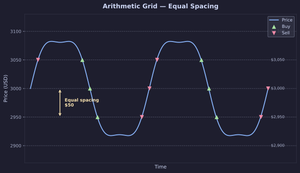
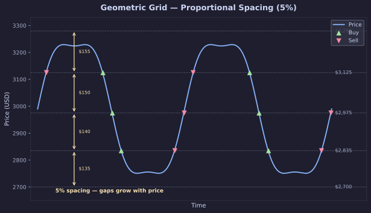
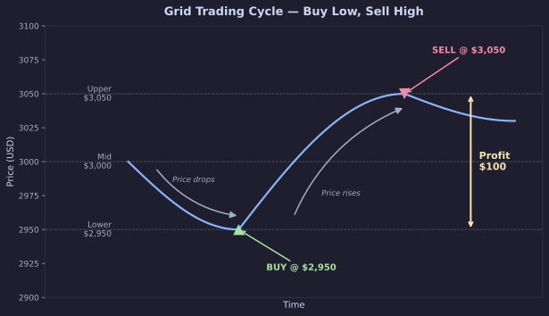
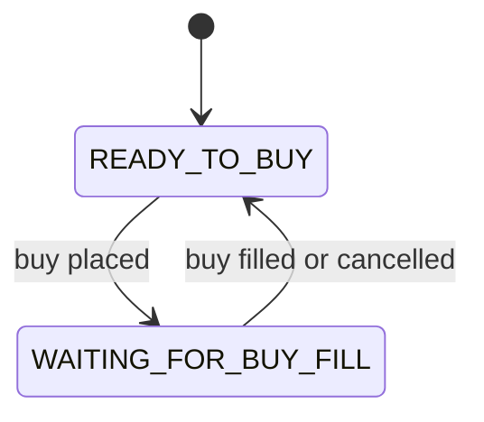
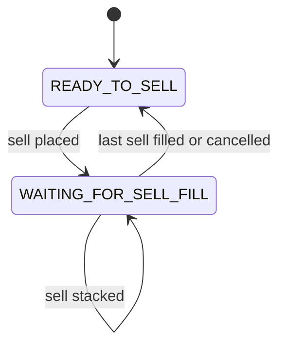
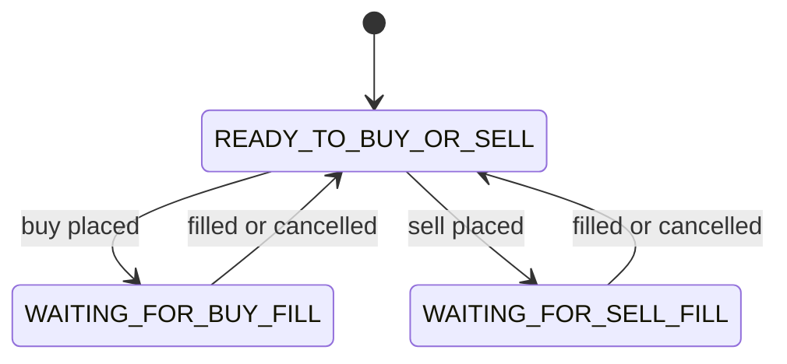

# Grid Trading Concepts

Grid trading is a strategy that places buy and sell orders at predefined intervals above and below a set price. The goal is to capitalize on market volatility by buying low and selling high at different price points.

## Grid Spacing Types

### Arithmetic Grid

In an arithmetic grid, price levels are spaced **equally**. The distance between each level is constant.

**Example** — Price at $3,000 with $50 spacing:

| Level | Price |
|-------|-------|
| 5 | $3,100 |
| 4 | $3,050 |
| 3 | $3,000 (current) |
| 2 | $2,950 |
| 1 | $2,900 |

Best for assets with **stable, linear** price fluctuations.



### Geometric Grid

In a geometric grid, price levels are spaced **proportionally** by a percentage. Intervals grow or shrink exponentially.

**Example** — Price at $3,000 with 5% spacing:

| Level | Price |
|-------|-------|
| 5 | $3,280 |
| 4 | $3,125 |
| 3 | $2,975 |
| 2 | $2,835 |
| 1 | $2,700 |

Best for assets with **significant, unpredictable volatility** and exponential price movements.



### When to Use Each Type

| Criteria | Arithmetic | Geometric |
|----------|-----------|-----------|
| Market behavior | Ranging, stable | Trending, volatile |
| Level distribution | Uniform spacing | Wider at extremes |
| Risk profile | Lower per trade | Adapts to swings |

## Grid Strategies

### Simple Grid

Splits the grid at its central price. Levels at or below the centre only buy, levels above it only sell.

- At start, buy orders go on the lower levels below the current price and sell orders on the upper levels above it.
- When a buy fills, its level is free again at once, and the sell goes on the lowest free upper level. If every upper level already holds a sell, the new sell is stacked on the lowest one.
- When a sell fills, its level is free again once it holds no other sell, and the rebuy goes on the highest free lower level. If no lower level is free, the proceeds stay in fiat.

A round trip runs from a lower level to an upper level, so it earns at least the gap between the two halves and happens less often than in the hedged grid.



### Hedged Grid

A classic grid: every level but the top one can buy, every level but the bottom one can sell, and a level never holds more than one order.

- At start, the level closest to the current price stays free. The other levels get a buy below the price or a sell above it.
- When a buy fills, the sell goes on the level just above. When a sell fills, the rebuy goes on the level just below.
- Each fill frees its own level and takes the free one next to it, so a free level stays next to the price. If that level is still busy because several fills were handled at once, the paired order is skipped and logged as an error.

A round trip earns one grid spacing.

## Grid Level Lifecycle

Each level has a home state, the state it holds while free:

| Level | Home state |
|-------|------------|
| Simple grid, lower half | `READY_TO_BUY` |
| Simple grid, upper half | `READY_TO_SELL` |
| Hedged grid, top level | `READY_TO_SELL` |
| Hedged grid, any other level | `READY_TO_BUY_OR_SELL` |

Placing an order moves the level to `WAITING_FOR_BUY_FILL` or `WAITING_FOR_SELL_FILL`. The level returns to its home state when its last open order fills or is cancelled.

Simple grid, lower level:



Simple grid, upper level:



Hedged grid, middle level:



## Asymmetric Order Sizing (Buy/Sell Ratio)

By default, the bot uses the full computed quantity for both buy and sell orders (`buy_ratio: 1.0`, `sell_ratio: 1.0`). You can override this to create asymmetric strategies via the `buy_ratio` and `sell_ratio` parameters.

**Use case — Crypto accumulation in a bull market:**
Set `sell_ratio: 0.5` to sell only half the quantity on each sell cycle. The surplus crypto stays in your free balance, letting you accumulate over time while still capturing grid profits.

| Parameter | Effect |
|-----------|--------|
| `buy_ratio` | Applied to all buy orders (initialization + paired buys after a sell fill). |
| `sell_ratio` | Applied to all sell orders (initialization + paired sells after a buy fill). |

Both ratios accept a value between `0` (exclusive) and `1.0` (inclusive). A value of `1.0` means the full quantity — identical to default behavior.

**How it works:**

- At **grid initialization**, the base order size is `total_balance / num_grids / price`. The ratio is applied: `base_size * ratio`.
- On a **buy fill**, the paired sell quantity is `filled * sell_ratio`.
- On a **sell fill**, the paired buy quantity is `filled * buy_ratio`.
- Surplus crypto (the portion not sold) remains as free balance.

!!! note
    With a ratio below 1.0, order sizes compound down across cycles (e.g., with `sell_ratio: 0.5`: 1.0 → 0.5 → 0.25 → …). This is by design for accumulation strategies.

## Configuration

Configure grid strategy in your `config.json`:

```json
{
  "grid_strategy": {
    "type": "simple_grid",
    "spacing": "geometric",
    "num_grids": 8,
    "range": {
      "top": 200,
      "bottom": 250
    },
    "buy_ratio": 1.0,
    "sell_ratio": 0.5
  }
}
```

See the [full configuration reference](../configuration/config-file.md) for all available parameters.
